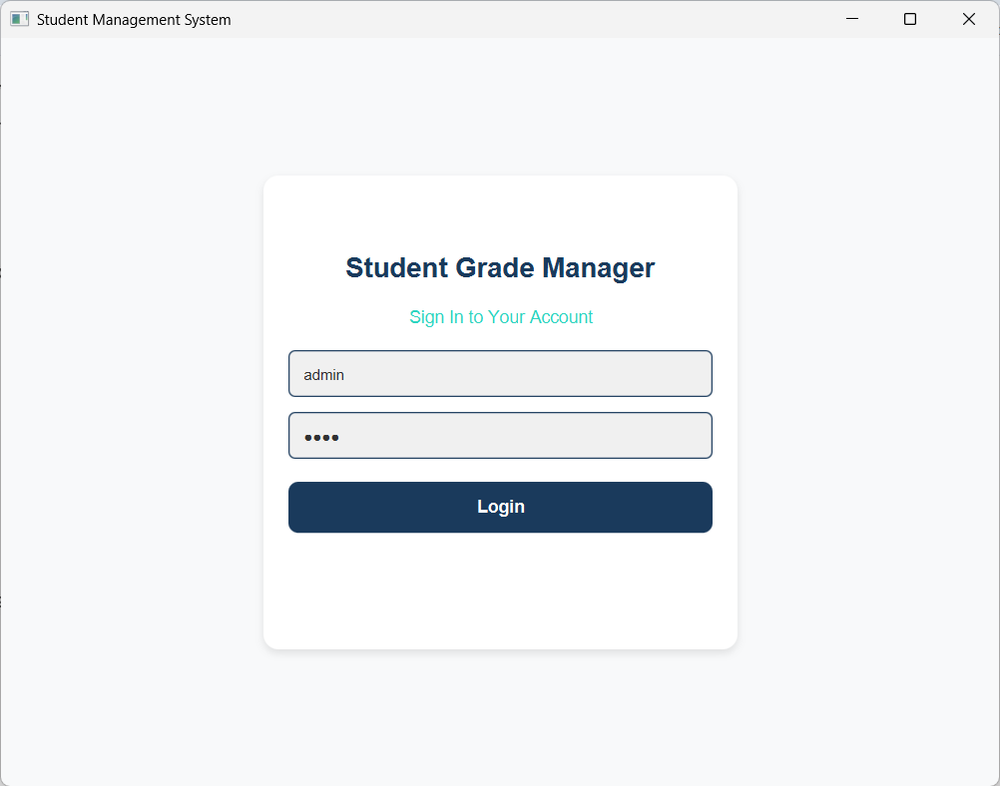
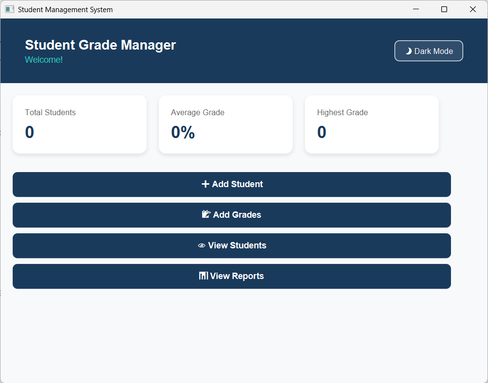
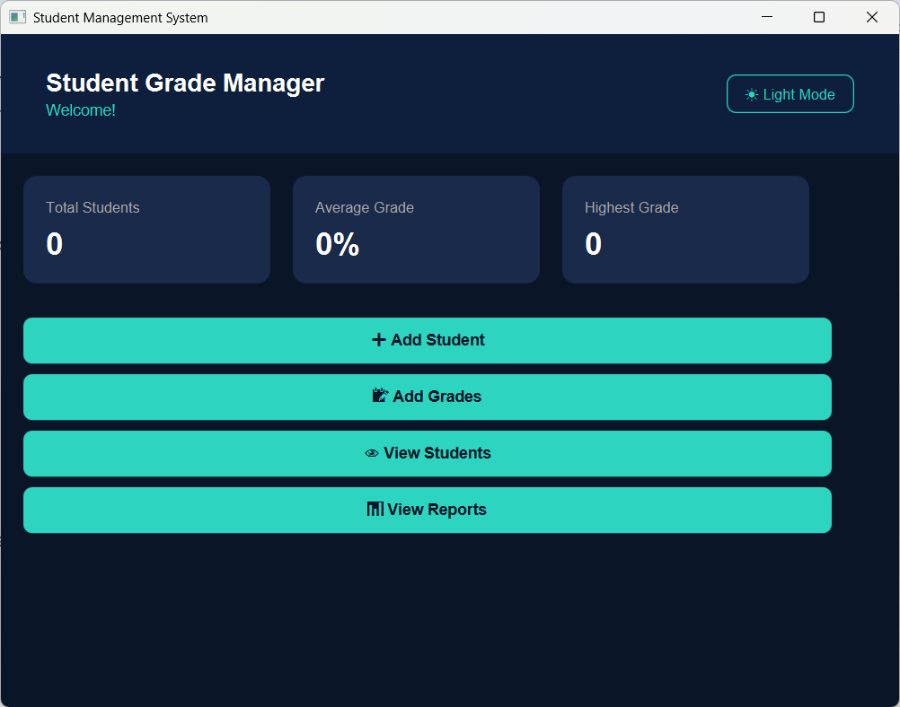

# 🎓 Student Grade Manager (JavaFX Desktop Application)

A robust, full-featured desktop application built with **Java** and **JavaFX** designed to manage student records, subject grades, and academic performance statistics efficiently. It features persistent binary file storage, input validation, and a sleek user interface supporting both **Light** and **Dark Modes**.

---

## ✨ Key Features

* **MVC Architecture**: Clean separation of concerns with dedicated controllers and model classes.
* **Dynamic Theme Toggle**: Seamless switching between Light and Dark modes across all screens.
* **Persistent Storage**: Data is securely saved locally using Java object serialization (`students.dat` and `grades.dat`).
* **Interactive Statistics**: Real-time calculation of total students, class averages, highest, and lowest grades.
* **Robust Validation**: Built-in error handling for student IDs, names, and grade boundaries (0.0 - 100.0).

---

## 🚀 How to Run the Project

### Prerequisites
* **Java Development Kit (JDK 17 or higher)**
* **Apache Maven**
* An IDE such as **Apache NetBeans 21** or **IntelliJ IDEA**

### Running via IDE (Recommended)
1. Open the project in your IDE (e.g., NetBeans).
2. Locate the main application class: `com.mycompany.studentgrademanager.StudentGradeManager`.
3. Right-click the file and select **Run File** (or press `Shift + F6`).

### Running via Maven Terminal
Open your terminal inside the project root directory and run:
bash
mvn clean javafx:run

---
### Screen Showcase
| Screen Name | Light Mode | Dark Mode |
| :--- | :---: | :---: |
| **Login Screen** |  | /
| **Dashboard** |  |  |
| **Add Student** |  |  |
| **Add Grade** |  |  |
| **View Students** |  |  |
| **View Reports** |  |  |

---

## 👥 Contributors & Team Roles

This project was successfully developed collaboratively by the following team members:

| Name | Role | Responsibilities & Contributions |
| :--- | :--- | :--- |
| **[Reham Wan-Deraman](https://github.com/RehamsCloud)** | Project Leader & Developer | Led the team coordination, developed the **Add Student** interface, implemented the `Student` model class, and built its corresponding controller. |
| **[Maram Aljahdali](https://github.com/MaramAljahdali)** | UI/UX & Dashboard Developer | Designed and developed the **Dashboard** interface, created the core global **CSS stylesheet** applied across the entire project, and built its controller. |
| **Rowaina Alharbi** | Authentication Developer | Developed the **Login** screen, implemented authentication logic, value validation, and its corresponding controller. |
| **Rafah Alsharif** | Grade Management Developer | Developed the **Add Grade** interface, implemented the `Grade` model class, and built its corresponding controller. |
| **Jana Alkabkabi** | Reports & Student Records Developer | Developed the **View Students** table interface and the **View Reports** statistics screen, along with their respective controllers. |
